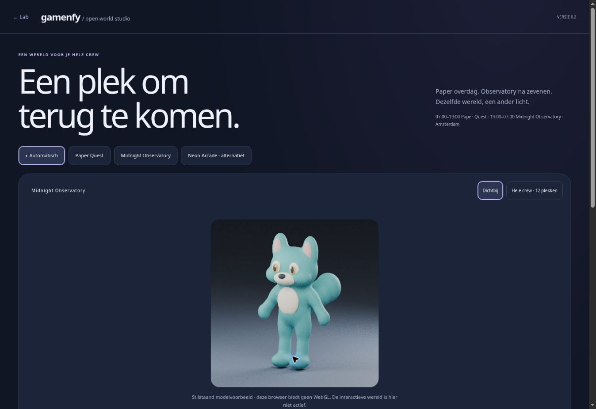

# Overnight visual build · 11 November 2026

Implemented by ChatGPT (OpenAI) from Joey’s direct feedback. Main presentation changes were explicitly requested; experimental model/world stay in Lab.

## What changed

- Home: the 59px companion badge becomes a 145–155px image in its own full-width hero above the agenda. The approved existing Home art remains the source.
- Daily Missions: fixed, safe-area-aware full-height scrolling container; `overflow-y:auto!important` beats its old inline `overflow:hidden`. The iframe height message cap is raised from 1,900px to 40,000px. Close returns focus and the previous Home scroll position.
- Shared presentation: `gamenfy-theme.js` and `.css` on the main personal app routes. Amsterdam time, DST-aware. Paper 07:00 inclusive–19:00 exclusive; Midnight otherwise. Re-evaluates each minute and on foreground. World-only previews include Neon Arcade. Theme selection does not write app state.
- Old Lab rig: GLTFLoader removes dots from names (`Thigh.L` becomes `ThighL`). The earlier animation looked up dotted names and therefore missed the legs. Resolve canonical aliases after loading.
- Open World Studio 0.2: new continuous, weighted skin, 18 bones, five animation clips; local Blender build. Distinct walk/run cadence, stance/swing and run flight phase. Runtime two-bone IK keeps stance ankle targets planted; root speed follows clip duration/stride.
- Shared world: a central beacon, path, observatory and 12 homes/roster slots. Camera toggles near/whole crew. All 12 use one base model with color variations; this is a density/layout trial, not 12 finished character designs. The 12th slot is explicitly free, not a new canonical mission.
- Demo walk → arrival → celebration → illuminated beacon. No real completion, XP, health, budget, auth or cloud mutations.
- Loading/WebGL failure states, reduced-motion pause, background pause, context-loss handling, DPR cap, shared geometry/skeleton clones and FPS/triangle display.
- Release feed and top-of-Lab shortcut updated.

## Validation

- 133 browserless smoke files passed locally, including existing mission/Fitbit/private/XP regressions and the new theme/motion checks.
- Corrected stale test expectations that hard-coded old cache query strings. Behavior assertions remain.
- Browser used a data-only Home fixture with the real Home code. Open/close and scrolling to the final 12th card were observed; the larger hero and visible level were inspected. No account writes were needed.
- Browser observed Paper/Midnight UI changes, readable World controls and the explicit no-WebGL fallback. This cloud browser has WebGL disabled; the interactive 3D canvas could not be visually playtested here.
- Real GLB loaded in Three.js, five clips and both leg chains verified. Runtime solver sampled at 120 phases per gait. Straight-line stance ankle drift < 0.001 world unit (recorded values < 0.000001) in z/vertical. This measures anchors, not shoe pressure, turning slip or subjective naturalness.
- Actual Blender model renders checked in rest, walk and run. Not a claim that Joey has approved the aesthetic.
- Real iPhone/PWA scrolling, rendering speed, memory and the full interactive mission need device confirmation.

## Reproduce

Blender 4.3.2:

```sh
blender -b --python tools/build_observatory_fox.py -- /absolute/output
```

The build creates GLB, base64, metadata, Blender source and rest/walk/run renders. Runtime loads the base64 GLB once; geometry is shared by skeleton clones. Metadata includes the measured contact report. Regenerate it with Three.js 0.170.0 installed (e.g. a local `npm install --no-save three@0.170.0`):

```sh
node tools/measure_observatory_contact.mjs
```

Run browserless regression files with Node 22+ using `node tests/<name>-smoke.js`; GitHub Actions runs all matching files.

## Research / tool choice

Primary references checked: Three.js SkeletonUtils cloning and CCDIKSolver documentation; Meshy official rigging/animation API documentation. Actual implementation uses an analytic two-bone IK solver and original Blender assets, no external generation service.

- https://threejs.org/docs/#examples/en/utils/SkeletonUtils
- https://threejs.org/docs/#examples/en/animations/CCDIKSolver
- https://docs.meshy.ai/en/api/rigging-and-animation

Meshy CLI was available but not authenticated. No login, purchase or credit use was initiated. Higgsfield was not used, as requested. No refund/account action was taken.

## Published checkpoint

Functional commit: `7c9149517384d57b952754ab68ee2383052d2909` (tree `04265fab9deed08406dbde9ce78d86730833674a`). GitHub Actions run `43116587208` / job `130846034155`: success. Exact Vercel production deployment `dpl_Cko4S8kw3uirN5fPgB5iPRPrjFnC`: READY. Live Home, Lab, World route and shared CSS returned HTTP 200 with the new markers. Lab’s top shortcut points to World 0.2. The source tree on GitHub matches the tested local tree exactly.

Live browser proof (desktop, explicit no-WebGL fallback):


