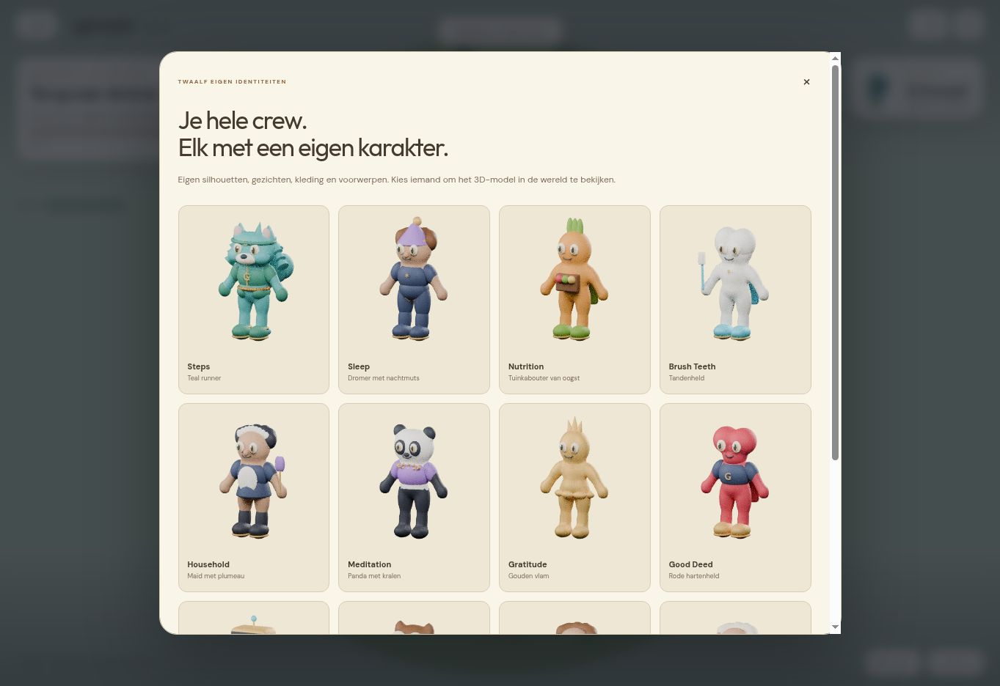
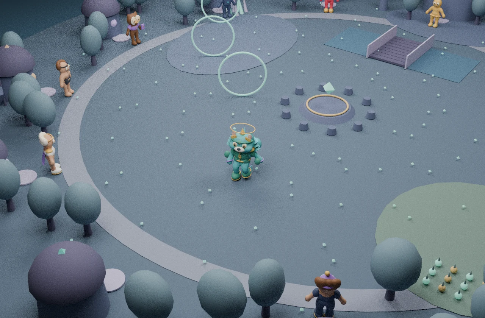

# Steps · The First Light — two critical reviews

Built by ChatGPT (OpenAI), 12 November 2026. Joey requested more game feel, separate habit characters, Steps through the end of its evolutions, and at least two critical self-reviews. This is the implementation and evidence, not a claim that subjective approval has already been received.

## Review 1 — Is this what Joey asked for?

- A playable loop: keyboard, ground taps and mobile joystick → collect / ordered route / dash gates / rune puzzle / time trial / escort → return to the altar → reward and evolution → new chapter.
- Ten chapters, all nine transitions from form 1 through form 10, then an actual ending and free exploration. Steps gains visible equipment, a new silhouette, energy trails, astral particles and a solar crown/halo. The bridge unlocks at form 6. Dash unlocks at form 4.
- Twelve different original skinned models. The other eleven figures have different topology, faces, silhouettes, materials and props: owl, dreamer, garden guardian, tooth hero, maid, panda, golden flame, heart hero, screen robot, athlete and astral guardian. They use compatible joint animation clips, not a recolored fox.
- Existing approved Steps art is visible as a reference; its jade runner, gold G details and progressively stronger energy guide the 3D interpretation. Approved Park assets were not overwritten.
- Lab progression saves only to `gamenfy_lab_steps_adventure_v1`. Existing public habit levels remain 0–10. The optional real-form view reads the last known local `walking.score` and uses `min(score + 1, 10)` without changing history or awarding real XP.
- Main/Home visuals and mission writers were not changed by this pass.

Findings corrected in this round:

1. Reloading a partial timed route could retain its provisional pickup currency. Reset its partial currency with its partial route. The same rule applies after the wrong rune order.
2. A completed game originally stopped movement. The awakened island is now explorable.
3. A square coordinate limit allowed the character outside a circular island. Add a circular bound and physical outer walls; clamp ground-tap targets inside it.
4. The rune puzzle lacked visible rune names. Add Maan / Blad / Ster labels and remove prompts for runes already activated.
5. The form-five description promised an east-path unlock that had not been implemented. Its reward now accurately describes the scout backpack.

## Review 2 — Does it feel like Joey’s intended game?

The first visual pass was still too close to a sparse character showroom. Revisions:

- The game fills the viewport. One compact objective cluster, a form portrait, energy and contextual action controls protect the center of play. Journals, crew and the evolution gallery open on demand.
- Add an orchard, crystal ridge, observatory district, visible wind gates, pond/bridge, distinct house accents, planted paths, light pickups and milestone stones.
- Make the fox ears and cheek silhouette sharper; make the jade sportswear readable; make later forms gain physical geometry plus real-time effects. Form previews are separate from campaign unlocks.
- Use a real awake/sleepy face difference for the first form, separate walk/run clips, motion-distance-driven clip time and post-animation foot IK. Reuse the checked rig rather than reintroducing rigid hopping limbs.
- The initial ending left the final milestone and two houses unlit. The completed state now lights the whole crew and all milestones.
- A crew preview could initially focus the fox while the selected model was still streaming. It now focuses that character’s own location.
- The fallback is an explicitly labeled, playable 2D map. It includes the same objectives, rewards, hazards and save system, and has its own crafted map treatment. It does not claim to be animated 3D.
- Finish the dreamer’s pajamas, maid’s boots and the heart hero’s armor; increase mobile crew cards to two columns, support portrait and short landscape layouts, keep dialogs scrollable, preserve safe areas and gate movement while menus/inspection are open.
- Batch static world geometry by material and attribute layout. The exported full scene with all twelve characters and the highest Steps form stays under 180 visible primitives before transient burst effects. This is a budget check, not a phone FPS claim.

## Verification

- All 134 browserless smoke files passed locally, including canonical mission, Fitbit, XP, privacy and existing regressions.
- New regression tests drive the complete campaign through normal movement and interactions: all ten chapters, all ten forms, exact one-time rewards (1,475 stars), dash lock/cooldown, rune order, retry/reload, save version guards and exploration after the ending.
- `tools/playtest_steps_quest.mjs` repeats the full campaign using actual Rapier capsule collisions and gate unlocks. It reaches the ending with all ten completed chapters, nine evolution transitions and the same 1,475 stars.
- All twelve actual GLBs load in Three.js. Each has a compatible skinned rig; Walk and Run are sampled across 80 phases per model, with finite ground-safe ankle positions at the runtime scale and rotated root. See `docs/review/steps-campaign-2026-11-12.json`.
- Browser: start, collect the first route, return to the altar, evolve, resume after reload, ten-form gallery, separate crew gallery, character preview and return, modal scrolling and a 390×844 phone-layout fixture. The phone body has no horizontal overflow. The real-device touchscreen was not available.
- CPU render exports the actual runtime scene composition and actual model geometry to GLB, then reviews it in Blender. `assets/game/review/world-review.webp` is this offline layout review, not a browser GPU screenshot.
- This cloud browser disables WebGL. Its playable fallback and UI were exercised, while geometry/rig/world composition were checked separately. Real Safari/iPhone GPU behavior, timing and aesthetic approval remain open. A native Chromium attempt also could not be controlled because its accessibility provider was unavailable. No claim of GPU playtesting is made.

## Reproduce / maintain

Dependencies used outside the buildless production repo: Three.js 0.170.0, Rapier compat 0.18.0, glTF Transform core/functions 4.2.1, Blender 4.3.2. Runtime imports are pinned.

```sh
blender -b --python tools/build_quest_crew.py -- /absolute/output
node tools/optimize_quest_crew.mjs /absolute/output assets/game/crew
node tools/playtest_steps_quest.mjs
node tools/render_quest_world.mjs /absolute/world.glb
blender -b --python tools/render_quest_world.py -- /absolute/world.glb /absolute/review.png
```

The ten Steps forms are cumulative geometry groups (`unlock_form`, plus a first-form eyelid group), so skin/bone ownership is stable. NPCs each have their own mesh and use the compatible Steps motion clips. Other habits have original animated base models; their full individual ten-form 3D sets are not yet authored.

No Higgsfield was used. No login, purchase, private habit read or real habit completion was performed. Primary technical references checked: Three.js SkeletonUtils documentation and Rapier’s official character-controller guide.

- https://threejs.org/docs/pages/module-SkeletonUtils
- https://rapier.rs/docs/user_guides/javascript/character_controller/

## Browser evidence




